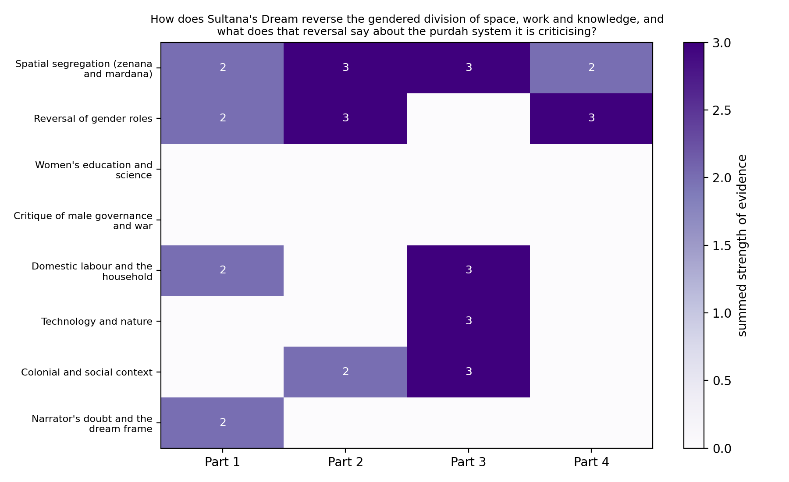
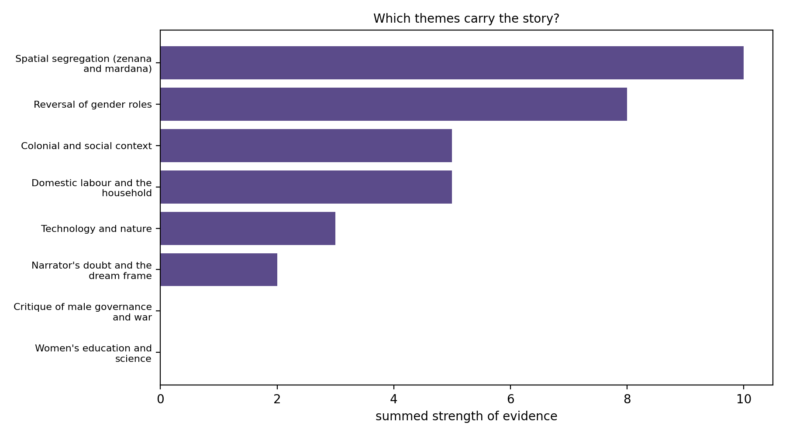

# Synthetic Reading of "Sultana's Dream"

**Assignment 3 · Synthetic reading · Monsoon Semester 2026**
Author: [Your Name] · [Department, Institution]

**Abstract.** Rokeya Sakhawat Hossain's "Sultana's Dream" (1905) imagines a country where women run everything and men stay indoors. I used it to try out *synthetic reading*, the seven-step method from the class handout, in which a human reads part of a text, forms a research question, and then uses an LLM to collect evidence from the whole text. My question was: **how does the story reverse the gendered division of space, work and knowledge, and what does that reversal say about the purdah system it criticises?** A local LLM sorted the story into eight themes, a script counted them, and I read the counts through feminist spatial criticism and feminist standpoint theory.



*Heatmap: how strongly each theme shows up in each quarter of the story. Only quotations that were checked against the text are counted.*



*Bar chart: the same evidence added up over the whole story.*

The reading of these charts is in [`interpretation.md`](interpretation.md). One thing to know before looking at them: the two empty rows (education and science, critique of male governance) are **not** a finding about the story. They are empty because the only quotations the model gave for them failed my exact-match check. The interpretation explains this.

---

## Why this story

- It is short (about 4,000 words), so a small local model can read all of it in four pieces.
- It is written in English, and local models are much more reliable in English than in Bengali or Hindi.
- It is out of copyright, so the whole text can sit in this repository.
- It makes an argument I can test. The text sets up a reversal, so I can ask where the reversal is built and with what.

## The seven steps and where each one lives

| Step | What I did | Files |
|---|---|---|
| 1. Partial reading | Split the story into 4 equal parts (35 paragraphs each) and read a random 20% of each part, 7 paragraphs per part, 28 in total (random seed 2026) | [`scripts/partial_reading.py`](scripts/partial_reading.py), [`partial_reading.txt`](partial_reading.txt) |
| 2. Initial impression | Wrote down what I noticed, my position as a reader, the research problem and the frameworks | [`positionality_and_method.md`](positionality_and_method.md) |
| 3. Text upload | Cleaned the full text and gave all of it to the model in four ordered segments | [`scripts/preprocess.py`](scripts/preprocess.py), [`corpus/`](corpus), [`run_extraction.py`](run_extraction.py) |
| 4. Query generation | Wrote the prompt: research question, theoretical lens, fixed theme list, strict output format | [`prompt.txt`](prompt.txt), [`themes.json`](themes.json) |
| 5. Extraction | The model returns theme, quotation, note and strength for every hit; the results are written as a Python file | [`Theme_JSON.py`](Theme_JSON.py) |
| 6. Computation and visualisation | Heatmap of themes by story part and bar chart of totals | [`visualise.py`](visualise.py), [`figures/`](figures) |
| 7. Interpretation | Read the charts through theory | [`interpretation.md`](interpretation.md) |

## How it was done

**Partial reading.** `partial_reading.py` splits the text into paragraphs, divides them into four equal parts and picks 20% of each part at random. It records the part number and position of every paragraph it picks (for example `[2.16]` is the 16th paragraph of part 2), so I can say exactly what I did and did not read. The first lines I read already show the pattern the project follows: "Where are the men?" (1.29), "Just as we are kept in the zenana?" (1.33) and "how unfair it is to shut in the harmless women and let loose the men" (2.1).

**Positionality and method.** Before touching the model I wrote down what I noticed, where I am reading from, and what could go wrong. This step is easy to skip and it is the point of the method, because it decides what question the model is asked.

**The prompt.** [`prompt.txt`](prompt.txt) has eight labelled blocks: role, research question, theoretical lens, the text segment (with its place in the story), the task, a fixed list of eight themes, rules, and the output format. The rules tell the model to quote exactly, to return nothing for themes that are not present, and not to use outside knowledge about the author. The eight themes are in [`themes.json`](themes.json) so that the prompt and the charts use the same labels.

**Extraction.** `run_extraction.py` sends each of the four segments to `qwen2.5-7b-instruct` running in LM Studio at temperature 0, and asks for JSON in a fixed schema. For each hit the model gives the **theme**, a word-for-word **quotation** of 25 words or fewer, a short **note**, and a **strength** from 1 (faint) to 3 (central).

**Checks built into the script.**

- Every quotation is searched for in the segment it came from. If it is found word for word, `quote_verified` is `True`. The charts count only verified quotations.
- Themes must come from the fixed list. A hit with an invented label is dropped.
- Temperature 0 means a second run gives nearly the same answer.

**Visualisation.** `visualise.py` reads `Theme_JSON.py`, adds up the strength scores for each theme in each part, and draws the two charts.

## Output

The model returned **20 hits**. **13** quotations were verified and **7** were not. A sample of what is in [`Theme_JSON.py`](Theme_JSON.py):

| Part | Theme | Quotation (from the story) | Strength | Verified |
|---|---|---|---|---|
| 1 | Spatial segregation | "We shut our men indoors." | 2 | yes |
| 1 | Narrator's doubt and the dream frame | "I am not sure whether I dozed off or not. But, as far as I remember, I was wide awake." | 2 | yes |
| 2 | Spatial segregation | "But dear Sultana, how unfair it is to shut in the harmless women and let loose the men." | 3 | yes |
| 2 | Colonial and social context | "We have no hand or voice in the management of our social affairs. In India man is lord and master…" | 2 | yes |
| 3 | Spatial segregation | "On the following day the Queen called upon all men to retire into zenanas for the sake of honour and liberty." | 3 | yes |
| 3 | Technology and nature | "They invented an instrument by which they could collect as much sun-heat as they wanted…" | 3 | yes |
| 3 | Women's education and science | "Education was spread far and wide among women, and early marriage also was stopped…" | 3 | **no** |

Summed strength per theme over the whole story (the bar chart in numbers):

| Theme | Total | By part (1, 2, 3, 4) |
|---|---|---|
| Spatial segregation (zenana and mardana) | 10 | 2, 3, 3, 2 |
| Reversal of gender roles | 8 | 2, 3, 0, 3 |
| Colonial and social context | 5 | 0, 2, 3, 0 |
| Domestic labour and the household | 5 | 2, 0, 3, 0 |
| Technology and nature | 3 | 0, 0, 3, 0 |
| Narrator's doubt and the dream frame | 2 | 2, 0, 0, 0 |
| Women's education and science | 0 | no verified quotation |
| Critique of male governance and war | 0 | no verified quotation |

## What the results do and do not show

- **The two empty themes are a side effect of my checking.** The seven unverified quotations are all real passages from the story. I searched for them by hand. The model copied the first part correctly and then paraphrased, stitched two sentences together or added a few words of its own. My exact-match check rejected them, which is the right behaviour for a check like this, but it means the education passage and the passage about the Queen refusing to hand over refugees (and the war that follows) are missing from the charts. They are in `Theme_JSON.py`, and I use them by hand in the interpretation.
- **The labels are noisy.** Two of the five "domestic labour" points are about something else (a shy walk in a street with no men; the Lady Principal marching to battle). A 7B model with eight overlapping labels will do this.
- **Strength scores are the model's opinion.** Adding them up treats a rough 1 to 3 scale as if it were a measurement. I treat the charts as a map of where to look, not as proof.
- **The numbers are small.** 13 verified hits in 4,000 words is a pattern to discuss, not a statistic.

## How to run it again

You need Python 3.9 or newer and [LM Studio](https://lmstudio.ai) with a chat model loaded and the local server started.

```bash
pip install requests matplotlib

python scripts/preprocess.py corpus/sultanas_dream_raw.txt corpus/sultanas_dream.txt
python scripts/partial_reading.py corpus/sultanas_dream.txt   # writes partial_reading.txt
python run_extraction.py                                      # writes Theme_JSON.py
python visualise.py                                           # writes figures/*.png
```

Set `MODEL` in `run_extraction.py` to the exact name LM Studio shows. If a segment comes back as "unreadable reply", the script saves what the model said in `debug_segment_N.txt`. An empty or cut-off reply usually means the context length is too small (raise it to 8192 or more in LM Studio). Prose such as "I can't" usually means the wrong model is loaded (an embedding model cannot chat).

## Files for the assignment

The assignment asks for four things on GitHub: the corpus, the partially read lines, the prompt and the extracted themes. I uploaded those and the rest of the work as well, because it shows how the results were produced.

| Required item | File |
|---|---|
| Corpus | [`corpus/sultanas_dream.txt`](corpus/sultanas_dream.txt) (the raw copy is next to it) |
| Partially read lines | [`partial_reading.txt`](partial_reading.txt) |
| Prompt | [`prompt.txt`](prompt.txt) |
| Extracted themes | [`Theme_JSON.py`](Theme_JSON.py) |

## Links for the website

Replace `USERNAME` and `REPOSITORY` with the real names before submitting.

| File | URL |
|---|---|
| Corpus | https://github.com/USERNAME/REPOSITORY/blob/main/corpus/sultanas_dream.txt |
| Partial reading | https://github.com/USERNAME/REPOSITORY/blob/main/partial_reading.txt |
| Prompt | https://github.com/USERNAME/REPOSITORY/blob/main/prompt.txt |
| Extracted themes | https://github.com/USERNAME/REPOSITORY/blob/main/Theme_JSON.py |
