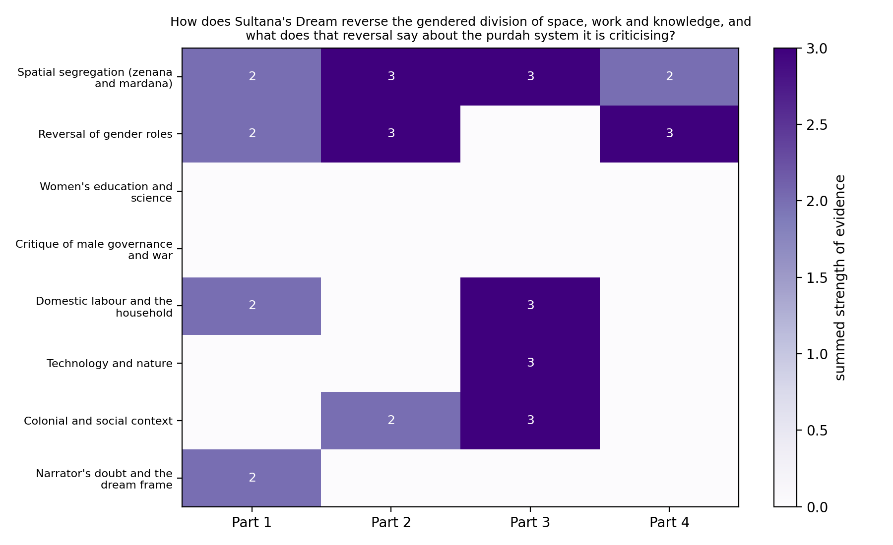
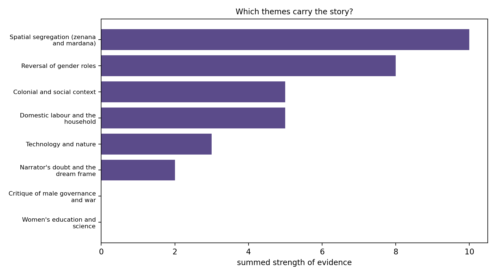

# Interpretation of the visualisations (step 7)

Written after running [`visualise.py`](visualise.py) and reading the evidence in [`Theme_JSON.py`](Theme_JSON.py).

## What the charts show

Of the eight themes, **spatial segregation** is the strongest (total 10) and the only one present in all four parts of the story (2, 3, 3, 2). **Reversal of gender roles** comes next (8), strong in parts 1, 2 and 4. **Colonial and social context** (5) sits in the middle of the story, in parts 2 and 3. **Domestic labour** (5) appears in parts 1 and 3. **Technology and nature** (3) appears only in part 3, and **the narrator's doubt and the dream frame** (2) only in part 1. Two themes are empty: **women's education and science** and **critique of male governance and war**.

The two empty rows need care. They are not absent from the story. Part 3 contains the passage "Education was spread far and wide among women, and early marriage also was stopped", and the account of the Queen refusing to hand over refugees, after which "the king declared war against our country". The model quoted these but altered or joined the wording, so they failed the exact-match check and are not counted. The charts therefore undercount part 3, which is where the story explains how Ladyland came to be. The numbers say where the model found clean evidence. They do not say what the story is about.

## Reading the pattern through theory

**Space is the constant.** Spatial segregation is the one theme that runs from the first part to the last, and I think that is the story's structure, not a coincidence. In part 1 the narrator's first question is "Where are the men?" (1.29); in part 4 the evidence is that "since the 'Mardana' system has been established, there has been no more crime or sin". Massey's idea that space is made by social relations, and that "proper places" are arrangements and not nature, explains why this works as an argument. When the story moves the men indoors and the women out, it shows that the old arrangement was a choice, and the narrator's laugh at "Just as we are kept in the zenana?" (1.33) is the moment she sees it.

**Reversal peaks where the argument is made, and is missing from the counts where it is explained.** The reversal theme scores 3 in part 2, where Sister Sara tells the narrator "how unfair it is to shut in the harmless women and let loose the men" and the narrator explains that in India "man is lord and master". It scores 0 in part 3, but that is the part where the Queen calls on "all men to retire into zenanas for the sake of honour and liberty" (the model's longer version of this quotation was the unverified one, though the sentence is in the story). So the reversal is probably present throughout, and the gap is a measurement problem.

**Knowledge and standpoint.** In part 3 the women's universities collect sun-heat and draw water from the air, while the men "laughed at the members of the universities and called the whole thing 'a sentimental nightmare'" (3.8). For standpoint theory this is the central point: the group that has been shut out of the male institutions builds a different kind of knowledge, and is not believed until it is useful in a war. The narrator's own line, "my scientific knowledge was very limited" (3.7), is the other side of the same argument. She shows what exclusion from education does, in the middle of a story about its reversal. The technology theme appears only in part 3 (3, solar heat) but the sampled lines in part 4 add electricity to till the fields and the air-car (4.9, 4.30).

**Purdah as the tool of defence.** The most interesting detail for the research question is the Lady Principal's request that "before we go out the men must enter the zenanas" and her reason, "for the sake of purdah" (3.29). Purdah is not abolished in Ladyland. It is kept, turned around, and used by the state to protect itself. I read this as the story's sharpest criticism: once seclusion is defended as honour and safety for men, the same defence of the seclusion of women starts to look like an argument and no longer like a fact of nature.

## Does it answer the research question?

Partly. My first impression from the partial reading was that inside and outside are swapped and that knowledge belongs to the women. The full run confirms both: spatial segregation and role reversal are the two largest themes, and part 3 adds the science. It complicates two things.

First, the story does not remove the enclosure. Men are still kept in, and Ladyland is described as safe and free from crime because of it. Read as satire, that makes purdah look absurd by pointing it at men. Read more critically, it leaves the idea that a group may be kept indoors for its own good in place, with the positions swapped. I do not think the charts can decide between these readings, and a close reading of part 4 would be the way to test it.

Second, the colonial context is thinner than I expected. The model's evidence for it is mostly a complaint about men's rule in India ("man is lord and master"), and a military defeat in part 3, and not a direct treatment of British rule. If the question were about empire and not gender, the theme list would need other labels.

On the dream frame: the doubt theme appears only in part 1 ("I am not sure whether I dozed off or not"). The story ends with the narrator slipping and "the fall startled me out of my dream". A dream lets the story say things that would be harder to say as a plan, and it also lets a reader dismiss them as a dream. The sampled lines support both readings.

## Limits

- **7 of 20 hits (35%) failed verification.** All seven are real passages, but the model changed or stitched the wording. This removed two themes from the charts entirely.
- **The labels are noisy.** Two of the five "domestic labour" points are about other things (a shy walk in a street with no men; the Lady Principal marching to battle).
- **The strength scores are the model's own,** and adding them treats a 1 to 3 scale as a measurement.
- **Eight overlapping labels and four equal-sized segments shaped the counts.** The segments hold equal numbers of paragraphs, not equal amounts of story, and the first two paragraphs of the file are the title and a publication note, not story text.
- **The sample is small.** 13 verified hits in about 4,000 words is enough to argue from, not enough to count with.
- **A 7B model cannot do a close reading.** It found passages that I then had to read myself. What a human adds is the sense of irony, the history of purdah and the reason the story was written in English.

## Works cited

Harding, Sandra. *Whose Science? Whose Knowledge? Thinking from Women's Lives*. Cornell UP, 1991.

Hartsock, Nancy C. M. "The Feminist Standpoint: Developing the Ground for a Specifically Feminist Historical Materialism." *Discovering Reality*, edited by Sandra Harding and Merrill B. Hintikka, D. Reidel, 1983, pp. 283-310.

Hossain, Rokeya Sakhawat. "Sultana's Dream." *The Indian Ladies' Magazine*, Madras, 1905.

Massey, Doreen. *Space, Place and Gender*. U of Minnesota P, 1994.

Synthetic reading method: the seven-step procedure given in the class handout for the Monsoon Semester 2026 assignment (source cited there: https://www.euppublishing.com/doi/pdf/10.3366/ijhac.2026.0378).
